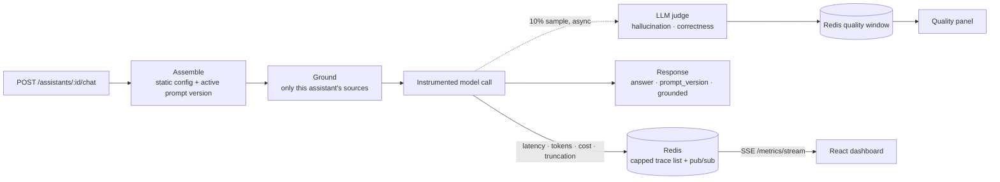

# AI Assistant & Evaluation Platform

**The integration layer for running several LLM assistants in production: versioned prompts promoted only when evals don't regress, per-request latency and cost tracking, sampled hallucination scoring, and live dashboards over Server-Sent Events.**

Shipping one chatbot is easy. Running a handful of assistants — each with its own model, prompt history, and knowledge sources — while knowing what they cost, how fast they are, and whether a prompt change made them worse, is the actual job. This repository wires those concerns together in FastAPI, Redis, and React.

> **Status: integration skeleton.** It assembles modules from earlier projects (database models, eval suite, LangGraph agent) that aren't included here, so it doesn't run standalone. See [Status](#status).

## How a chat turn flows

## Design decisions

- **Config and prompts are versioned separately.** `AssistantConfig` (Pydantic) holds model, temperature, a `max_output_tokens` ceiling, knowledge sources, and mode (`single` or `agent`). Prompt text lives in versioned database rows with exactly one active version per assistant, so a prompt can change or roll back without a deploy.
- **Promotion is eval-gated.** `deploy/gate.promote()` evaluates a candidate prompt version and activates it only if it doesn't regress correctness or hallucination against the baseline; otherwise the current version stays live.
- **Grounding is scoped per assistant.** Retrieval only searches the sources an assistant is configured for, and injects them as "use ONLY these facts" context.
- **Every call is measured.** Latency, prompt/completion tokens, USD cost from a per-model price table, and `finish_reason == "length"` truncation are recorded per request in a capped Redis list (last 1,000) and published for live dashboards.
- **Quality scoring is sampled and off the hot path.** 10% of answers are judged by the eval suite's LLM judge in a fire-and-forget task. The dashboard rolls them into hallucination rate, average correctness, and a combined `quality_score = correct × (1 − hallucination)`.
- **Live without polling.** `GET /metrics/stream` relays Redis pub/sub as `text/event-stream`; the React dashboard consumes it with `EventSource`, which reconnects automatically.

## Layout

| Path | Purpose |
|---|---|
| `app/config/` | Assistant config schema, registry (`support`, `sales`), and assembly with the active prompt |
| `app/routers/chat.py` | Single-call chat turn: assemble → ground → instrument → sample-score |
| `app/routers/agent.py` | Agent-mode turn for assistants configured with `mode="agent"` |
| `app/rag/` | Per-assistant knowledge sources and keyword retrieval (a vector-store stand-in) |
| `app/obs/` | Instrumented model call, pricing, trace store, metrics roll-ups, sampled quality scoring, SSE stream |
| `app/deploy/gate.py` | Eval-gated prompt promotion |
| `web/` | `Dashboard` (live traces over SSE) and `QualityPanel` (polled quality snapshot) components |
| `docker-compose.yml` | API, PostgreSQL 16, Redis 7 |
| [DEPLOY.md](DEPLOY.md) | Mapping the Compose stack onto ECS Fargate, RDS, and ElastiCache |
| [RUNBOOK.md](RUNBOOK.md) | On-call guide: frozen dashboards, cost spikes, quality drops |

## Tech stack

Python · FastAPI · Pydantic · SQLAlchemy · OpenAI SDK · Redis (asyncio) · React + TypeScript · Docker Compose. The agent route expects a LangGraph runtime.

## Status

The observability, config, and routing code is here; the pieces it depends on are not:

- **Missing modules:** `app.main`, `app.db.*` (models, sessions, prompt activation), `app.evals.*` (cases, judge, report), and `app.agent.run`.
- **No `Dockerfile` or dependency file,** so `docker compose up` can't build the `api` service.
- The Redis URL is hard-coded to `redis://localhost:6379` in the observability modules even though Compose sets `REDIS_URL`.
- The `QualityPanel` fetches `/assistants/{id}/quality`, which no router defines yet.
- RAG is keyword matching over three in-memory fact bundles.
